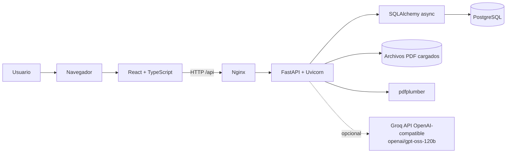

# Senus PLC Board Report

Aplicación web para cargar informes financieros de Senus PLC, detectar y revisar
periodos y cifras, calcular KPIs deterministas y consultar un dashboard. El flujo
está pensado para usuarios con rol `admin` (ingesta y revisión) y `viewer` (consulta).
El repositorio no acredita que exista un despliegue productivo ni cuál sea el estado
de una base de datos externa.

## Arquitectura observada



En Compose hay servicios para PostgreSQL 16, la API y el frontend. El contenedor del
frontend sirve el build de Vite con Nginx y reenvía `/api/` a FastAPI. Alembic ejecuta
las migraciones antes de iniciar Uvicorn. Los PDFs cargados se guardan como archivos;
las entidades financieras y de auditoría se guardan en PostgreSQL
(`docker-compose.yml`, `Dockerfile`, `backend/Dockerfile`, `nginx.conf`,
`backend/app/main.py`).

| Tecnología | Uso comprobable en el repositorio |
|---|---|
| React 19 y TypeScript | SPA, pantallas y contratos del cliente HTTP (`src/`) |
| Vite | desarrollo y build del frontend (`package.json`, `vite.config.ts`) |
| Recharts | gráficos del Dashboard (`src/components/Dashboard.tsx`) |
| FastAPI y Pydantic | API REST, validación de esquemas y documentación OpenAPI (`backend/app/`) |
| SQLAlchemy async y asyncpg | acceso asíncrono al modelo relacional (`backend/app/core/database.py`) |
| PostgreSQL | persistencia configurada en Compose (`docker-compose.yml`) |
| Alembic | migraciones versionadas (`backend/alembic/`) |
| pdfplumber y expresiones regulares | lectura de texto del PDF y extracción determinista (`backend/app/services/ingest.py`, `backend/scripts/extract_pdf.py`) |
| Groq, cliente OpenAI-compatible | segundo extractor e insights opcionales; requieren `GROQ_API_KEY` (`backend/app/core/config.py`, `backend/app/services/llm_extract.py`, `backend/app/services/ai_insights.py`) |
| pytest, Vitest, ESLint | pruebas backend, pruebas frontend y lint (`backend/tests/`, `src/api/client.test.ts`, `package.json`) |

La tabla describe el uso observado, no la motivación histórica del autor al elegir
cada tecnología; esa motivación no está documentada en el código.

El modelo configurado por defecto es `openai/gpt-oss-120b`. La URL base es la API
OpenAI-compatible de Groq. Sin clave, el parser determinista y la aplicación central
siguen disponibles; no se puede producir una nueva extracción LLM ni generar
comparaciones o nuevos insights de IA. Los insights verificados ya persistidos pueden
seguir disponibles (`backend/app/core/config.py`,
`backend/app/services/llm_extract.py`, `backend/app/services/ai_insights.py`).

## Pantallas y roles

- **Login:** autentica mediante `/api/auth/login`; las contraseñas se almacenan con
  bcrypt y la API devuelve tokens JWT (`src/components/Login.tsx`,
  `backend/app/api/auth.py`, `backend/app/core/security.py`).
- **Company (vista por defecto):** informe de dirección: métricas, objetivo Senus 2030,
  pipeline, clientes, personas, hitos, 3 insights con IA y chat con IA
  (`src/components/Company.tsx`, `src/components/CompanyAI.tsx`).
- **Financials (Dashboard):** muestra KPI, origen/fórmula o nota de disponibilidad,
  gráficos de ingresos y márgenes, desglose de costes, puente EBITDA–cash flow, ratios
  y comparación entre periodos. Ya no muestra insights de IA ni la nota "How to read
  these ratios" (`src/components/Dashboard.tsx`).
- **Comparación de periodos:** el periodo seleccionado en la cabecera es uno de los
  dos; solo se elige con cuál compararlo. El orden siempre es cronológico (el más
  antiguo es la base, el más reciente va después) en tabla, puente y gráficas
  (`src/components/PeriodComparison.tsx`).
- **Documents:** lista documentos; permite a `admin` cargar PDFs, confirmar fechas,
  procesar columnas, revisar y corregir cifras, publicar y eliminar documentos.
  Incluye procedencia y ordenación por confianza de extracción
  (`src/components/Ingestion.tsx`, `backend/app/api/documents.py`).
- **Selector de periodo:** está en la cabecera global, no dentro del Dashboard
  (`src/components/Header.tsx`, `src/App.tsx`).
- **Permisos:** `viewer` consulta; las operaciones de escritura requieren `admin`
  en el backend. No hay un selector de audiencia ni permisos por audiencia
  (`backend/app/core/security.py`, `backend/app/api/`).

El Dashboard agrupa ratios de rentabilidad, caja/liquidez, solvencia y retornos.
Incluye Revenue, Gross Margin, Operating Margin, Cash y Cash Runway como tarjetas,
además de comparativas gráficas y datos de origen. MoM, ingresos por canal y bookings
se presentan como no disponibles en vez de estimarse (`src/components/Dashboard.tsx`,
`backend/app/services/metrics.py`).

## Modelo de datos

Las entidades SQLAlchemy principales y sus relaciones son
(`backend/app/models/financial.py`):

- `Document` contiene metadatos, ruta del PDF, estado, periodos detectados y payload
  de revisión. Puede tener varios `Period`.
- `Period` contiene fechas, etiqueta y documento de origen; agrupa partidas P&L,
  balance, cash flow, KPIs, insights y validaciones.
- `PnLItem`, `BalanceSheetItem` y `CashFlowItem` guardan cifras, origen, página,
  estado de revisión y factores de confianza.
- `KPI` guarda valor nullable, clase (`reported`, `derived` o `na`), fórmula y nota.
- `Insight` almacena texto, confianza calculada y JSON con fuentes/evidencia.
- `Validation` almacena regla, severidad, mensaje, esperado y observado.
- `User` almacena rol y hash de contraseña; `AuditLog` guarda operaciones y cambios.

## Ingesta de PDF y confirmación de periodos

1. **Carga y lectura:** solo se aceptan archivos `.pdf`. `pdfplumber` extrae texto
   página a página; en esta ruta no hay OCR (`backend/app/api/documents.py`,
   `backend/app/services/ingest.py`).
2. **Detección de fechas y columnas:** `period_detector.py` busca cabeceras de estados
   financieros y fechas mediante expresiones regulares. La etiqueta se deriva de
   inicio y fin; por ejemplo, FY2025 corresponde a 1 jul 2024–30 jun 2025 y HY2026
   a 1 jul 2025–31 dic 2025. El año fiscal termina el 30 de junio. Las cabeceras
   ambiguas como “Current period” y “Prior period” quedan sin fechas y requieren
   entrada manual.
   No se usa un LLM para validar o inventar fechas; el detector y las reglas de
   coherencia son deterministas (`backend/app/services/period_detector.py`).
3. **Confirmación antes de extraer cifras:** la UI muestra columnas, fechas y errores.
   No se procesa hasta confirmar todos los periodos sin errores. La etiqueta se
   vuelve a calcular al cambiar fechas. Los cambios manuales guardan usuario,
   fecha/hora y valores anteriores/nuevos en `audit_log`
   (`backend/app/api/documents.py`, `backend/app/schemas/documents.py`).
4. **Coherencia temporal:** se comprueba que las columnas detectadas tengan igual
   duración; si hay dos columnas, que el comparativo esté exactamente 12 meses antes;
   y que los encabezados detectados de P&L, balance y cash flow coincidan. Si falla,
   el documento queda sin confirmar y el procesamiento se bloquea
   (`backend/app/services/period_detector.py`, `backend/app/api/documents.py`).
5. **Extracción doble:** el parser regex extrae la columna seleccionada y conserva
   procedencia por página. Si hay `GROQ_API_KEY`, el extractor LLM devuelve partidas
   estructuradas con página y texto de origen; cada cifra debe aparecer en el texto
   de la página citada (`backend/scripts/extract_pdf.py`,
   `backend/app/services/llm_extract.py`).
6. **Reconciliación y revisión:** cuando ambos extractores discrepan, prevalece el
   parser determinista; el valor alternativo queda guardado y la partida se marca
   para revisión. Los valores sin acuerdo no se corrigen silenciosamente.
   `admin` puede confirmar o corregirlos; publicar actualiza el ciclo de vida del
   documento (`backend/app/services/reconciliation.py`,
   `backend/app/services/lifecycle.py`, `backend/app/services/ingest.py`).
7. **KPIs y validaciones:** tras extraer o corregir, el backend recalcula KPIs y
   comprobaciones contables con código Python (`backend/app/services/deterministic.py`,
   `backend/app/services/validation.py`).

   La precedencia del parser hace reproducible la selección inicial y deja la salida
   del LLM como evidencia alternativa para revisión; no implica que el parser sea
   infalible. Los KPIs se calculan con fórmulas Python para que el resultado no dependa
   de una respuesta de texto del modelo y pueda cubrirse con tests
   (`backend/app/services/reconciliation.py`, `backend/scripts/extract_pdf.py`,
   `backend/tests/test_kpis.py`).

   Si el procesamiento va a sustituir periodos ya existentes, el backend devuelve un
   conflicto y la UI pide confirmación antes de reintentar. La decisión y los periodos
   sustituidos quedan en el log de proceso (`backend/app/api/documents.py`,
   `src/components/Ingestion.tsx`).

La confianza por partida es la media simple de las comprobaciones aplicables:
coincidencia exacta entre extractores, presencia de la cifra en el texto de la página
y comprobaciones de identidades contables relacionadas. Si no hay segundo extractor,
el factor de coincidencia falla; las identidades sin datos suficientes no cuentan.
La pantalla permite ordenar por las cifras menos fiables
(`backend/app/services/reconciliation.py`, `src/components/Ingestion.tsx`).

## Vista Company y extracción narrativa

La vista por defecto (**Company**) muestra dirección, clientes, hitos, pipeline,
estrategia Senus 2030 y personas. Todo sale del PDF original, sin datos externos:

- `backend/app/services/narrative.py` extrae de forma determinista (sin LLM) el perfil,
  highlights, clientes, hitos, drivers y notas. Cada dato lleva la **página** y la
  **cita literal**; un dato cuya cita no aparece en esa página se descarta.
- Se guarda en `documents.narrative_json` (migración `e1f4a7c9d2b3`) durante la ingesta
  y se sirve en `GET /api/company?period=`. Si falta, se extrae al vuelo desde el PDF.
  Los datos sembrados sin PDF devuelven 404.
- `checks` contiene cruces entre cifras de la narrativa (p. ej. los ≈€425k de
  Nov–Dec deben caber en los ≈€700k cerrados en el periodo).
- `backend/scripts/compare_narrative_to_txt.py` compara la extracción con el TXT de
  referencia (`Otros/`); `tests/test_narrative.py` exige ≥99 % de cobertura.
- Tras actualizar: `python -m alembic upgrade head` y reprocesar el PDF desde Documents.
- La gráfica de objetivo solo dibuja la aritmética del objetivo (≥50 % anual sobre los
  ingresos FY25, `strategy.min_cagr_pct`); no hay previsión, porque el informe no dice
  cuándo el pipeline se convierte en ingresos.
- Los datos sin fuente en el PDF (precio de acción, CEO, ingresos por línea de producto)
  no se muestran.

### Insights y chat con IA (Company)

Son texto generado, no citas del PDF, y la vista lo indica. Requieren `GROQ_API_KEY`
en `backend/.env`; sin clave devuelven 503 y el resto de la vista sigue funcionando.

- `GET /api/company/insights?period=&force=` devuelve 3 interpretaciones (título + texto);
  se cachean en memoria del proceso y `force=true` las regenera.
- `POST /api/company/chat` responde preguntas con el historial reciente (máx. 8 turnos).
- El contexto es la narrativa extraída (sin citas ni páginas), las notas de `checks` y
  las partidas de los estados financieros del periodo; el prompt prohíbe inventar cifras,
  previsiones o probabilidades y sumar importes que `checks` marca como solapados
  (`backend/app/services/company_ai.py`, `backend/app/api/company.py`,
  `backend/tests/test_company_ai.py`).

## Datos, orígenes y KPIs

Cada cifra/KPI se clasifica como:

- `reported`: figura reportada en un documento o fuente identificada.
- `derived`: calculada por el sistema; la fórmula se devuelve como metadato.
- `n/d` (`na` en el esquema): no disponible, con nota explicativa cuando corresponde.

La ausencia se conserva como `null`; no se sustituye por cero. El catálogo incluye,
entre otros, márgenes, EBITDA, FCF, burn mensual, runway, ratios de liquidez,
solvencia, apalancamiento, retornos y DSCR. Algunos ejemplos de fórmulas son
`Gross profit / Revenue × 100`, `Cash / Monthly burn` y
`Net cash from operations / (Interest + abs(Loan repayments))`
(`backend/app/services/metrics.py`, `backend/scripts/extract_pdf.py`).

MoM, ventas por canal y bookings no están disponibles en las fuentes actuales y
aparecen como `n/d`. DSCR se deja `n/d` si el flujo operativo es negativo. El backend
rechaza comparaciones de distinta duración con HTTP 422; la serie YoY del resumen
también exige fechas de inicio con un año de diferencia y duración igual
(`backend/app/services/metrics.py`, `backend/app/api/financial.py`).

FY2025 es un periodo parcial, no un documento procesado: ingresos **836.991 €** y
138 cuentas de cliente proceden del enunciado del assignment; la caja inicial
**140.135 €** procede del cash flow HY2026. No se derivan para FY2025 márgenes,
EBITDA ni runway, y el resto de partidas está ausente (`backend/scripts/extracted/fy2025_extracted.json`,
`backend/tests/test_fixtures.py`).

## Validaciones y convenciones

Las comprobaciones deterministas usan tolerancia de **±1 €**. Se omiten si faltan
entradas requeridas; las identidades de subtotales tratan una partida ausente como
cero. Las reglas implementadas incluyen:

1. Revenue − Cost of sales = Gross Profit (**error**).
2. Activos menos pasivos = equity/net assets (**error**).
3. Resultado operativo + depreciación = EBITDA (**error**).
4. Cash al inicio + variación neta = cash al cierre (**error**).
5. Subtotales de balance iguales a la suma de sus componentes (**warning**).

La fuente de HY2025 contiene una discrepancia concreta: en la página 5 del PDF el
comparativo imprime revenue 340.931 €, cost of sales 69.600 € y Gross Profit
272.331 €. Sin embargo, `340.931 − 69.600 = 271.331`; la diferencia es 1.000 €,
superior a la tolerancia. La extracción conserva el subtotal impreso y la regla
contable lo señala, no lo corrige (`backend/data/Senus_HY2026_Interim_Results.pdf`,
`backend/tests/test_extract.py`, `backend/app/services/validation.py`).

El parser normaliza a negativo determinadas líneas de pérdidas si aparecen positivas,
incluyendo operating loss y loss for the period. EBITDA es derivado como resultado
operativo + depreciación. La dirección de otras partidas sigue el valor parseado del
documento; no se afirma que todos los costes se normalicen automáticamente
(`backend/scripts/extract_pdf.py`).

## Insights y comparaciones con IA (backend de Financials)

La interfaz de Financials ya no consume estos endpoints (`/api/insights/...`); se mantienen en el backend.

Los insights por periodo solo se generan para documentos publicados, partidas
confirmadas/corregidas, o el registro parcial FY2025 identificado en los fixtures.
Cada afirmación numérica requiere un claim estructurado ligado a un `source_id`; el
backend comprueba el valor contra la cifra/KPI fuente y que los números del texto
correspondan a claims verificados, con tolerancia de redondeo de media unidad de la
precisión mostrada. Las citas incluyen partida/KPI y página cuando está disponible.
Las frases causales solo se aceptan si la frase completa coincide con evidencia
textual de una página del PDF (`backend/app/services/ai_insights.py`).

La confianza no se toma del modelo: es `claims verificados / claims totales`. Los
insights aceptados y sus fuentes se guardan en `insights` y se presentan en
Dashboard por separado como dato e interpretación. La comparación narrativa entre
dos periodos aplica las mismas comprobaciones de elegibilidad, cifras y evidencia,
persiste sus fuentes y presenta las citas en la UI. El backend rechaza duraciones
distintas y no acepta una comparación si no supera la verificación
(`backend/app/services/ai_insights.py`, `backend/app/models/financial.py`,
`src/components/Dashboard.tsx`).

La generación de insights y comparaciones envía solo los KPIs disponibles y hasta
18 líneas fuente en total, no todas las partidas ni páginas completas. Estima el
tamaño de cada prompt para el log y reserva como máximo 800 tokens para la respuesta;
solicita `reasoning_effort` `low` al modelo Groq GPT-OSS. Los insights ya persistidos se devuelven sin regenerar;
el botón de reintento solicita generación explícita. Ante HTTP 413/429 se conserva el
contenido existente, se informa del límite en la sección de insights y se permite
reintentar manualmente; un encabezado de espera válido permite un único reintento
automático (`backend/app/services/ai_insights.py`, `backend/app/api/financial.py`,
`src/components/Dashboard.tsx`).

## Demo y datos reproducibles

Hay fixtures extraídos para HY2026, HY2025 y el FY2025 parcial en
`backend/scripts/extracted/`. En Compose, `SEED_FROM_DISK=false` evita que el arranque
cargue periodos automáticamente. El script `backend/scripts/reset_demo.py` borra los
registros de la base configurada, recrea los usuarios demo y carga esos tres fixtures.
Es destructivo y exige `--confirm`; antes de usarlo hay que verificar `DATABASE_URL`.
Los fixtures no restauran los PDFs originales. El reset no se ejecutó contra una base
de datos durante esta validación.

## Ejecución de pruebas y verificación

Comandos desde la raíz del repositorio:

```powershell
python -m pytest backend\tests -q
npm test -- --run
npm run build
npm run lint
```

Resultado observado en este checkout:

- Backend: **91 passed**, 7 warnings (Pydantic deprecated-config y clave HMAC corta
  en el test de seguridad).
- Frontend: **6 passed**.
- Build TypeScript/Vite: **correcto**; Vite advierte que el chunk JavaScript principal
  supera 500 kB minificado.
- Lint: **falla** en `react-hooks/set-state-in-effect` en
  `src/components/Dashboard.tsx`; además informa dos warnings de dependencias de
  hooks en `Dashboard.tsx` y `App.tsx`. No se afirma que lint esté limpio.
- CI (`.github/workflows/ci.yml`) ejecuta pytest, Vitest y build; no ejecuta ESLint.

Se hizo una comprobación puntual del texto extraído directamente del PDF real,
página 5, para las tres cifras comparativas de HY2025 señaladas arriba. No se hizo
una revisión visual independiente de todas las partidas del informe ni una llamada
de validación en vivo a Groq; los tests del proveedor usan respuestas simuladas.

## Limitaciones conocidas

- La ruta PDF extrae texto con `pdfplumber`; no hay OCR para páginas escaneadas.
- El parser está ajustado a estados tabulares de dos columnas y a las etiquetas y
  saltos de línea cubiertos por sus patrones/tests; no se verifica soporte general
  para cualquier diseño de informe.
- No hay datos mensuales, por canal o bookings en las fuentes incluidas; son `n/d`.
- FY2025 solo contiene los datos explícitos indicados arriba.
- El código de Dashboard muestra una referencia de “50% CAGR track” calculada como
  1,5 × ingresos FY2025; no es un KPI del catálogo ni una cifra calculada a partir
  de periodos mensuales (`src/components/Dashboard.tsx`).
- No hay selector de audiencia. Los roles actuales son `admin` y `viewer`.
- El restablecimiento de demo y el estado de una base externa no se verificaron
  ejecutando el script contra esa base.

## Desarrollo asistido por IA

### Herramientas utilizadas


### Qué pedí a cada herramienta


### Dónde corregí a la IA
