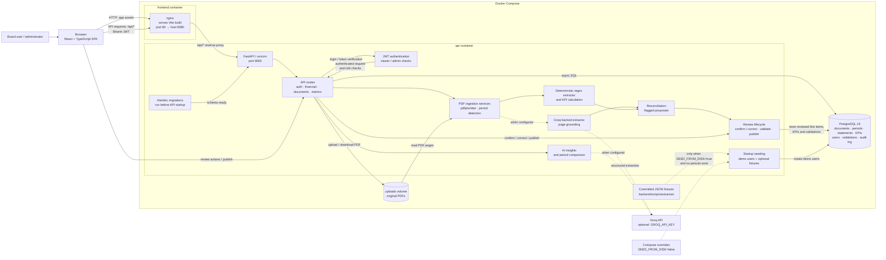

# Senus PLC — AI-native Board Report

An AI-native, full-stack platform that prepares a Board Report for **Senus PLC**
(Natural Capital management software, Euronext Access Dublin). It extracts financial
information from the company's source documents into a database, models the figures,
derives board-grade KPIs, and presents them through an interactive, CEO-facing dashboard
with AI-generated commentary.

It was built as the *Technology Graduate Assessment — Board Report* (Assiduous, 2026).

---

## Quick start (Docker)

Requires Docker with the Compose plugin.

```bash
# 1. Create the local environment file (never committed)
cp backend/.env.example backend/.env
#    Set GROQ_API_KEY in backend/.env to enable Groq-powered extraction and insights.
#    The dashboard and deterministic PDF extraction also work without a Groq key.

# 2. Build and run the full stack
docker compose up --build
```

| Service   | URL                              | Description                          |
|-----------|----------------------------------|--------------------------------------|
| Frontend  | http://localhost:8080            | React dashboard (login → board view) |
| API       | http://localhost:8000/docs       | FastAPI + OpenAPI docs               |
| Postgres  | localhost:5432                   | Database (`senus_board`)             |

The API creates the demo accounts on startup. The Compose configuration sets
`SEED_FROM_DISK=false`, so a fresh database has no reporting periods: upload a PDF
from the **Documents** tab or change the Compose `SEED_FROM_DISK` override to `true`
to load the committed
fixture data into an empty database. Sign in with **board@senus.com / senus123**
(administrator) or **viewer@senus.com / senus123** (read-only).

---

## Architecture



Solid arrows show the normal runtime path; dotted arrows are optional or
configuration-dependent. The frontend container serves the compiled React
application, while nginx also proxies `/api/*` to FastAPI. Alembic applies schema
migrations before uvicorn starts. PostgreSQL stores application state; the
separate Compose `uploads` volume stores source PDFs.

**Document processing:** an administrator uploads a PDF; the API stores it and
detects candidate periods. The deterministic parser and optional Groq extractor
work independently; LLM figures are checked against cited page text before
reconciliation. The resulting proposal is persisted for review. Confirming or
correcting items recomputes KPIs and validations; publishing advances the
document/period lifecycle. Uploads, processing, edits, review actions and
publishing are recorded in `audit_log`.

In the current UI, **Confirm & Process** saves the confirmed period labels; the
administrator then starts extraction with **Process**. The process endpoint
currently iterates the document's detected periods, so the confirmation is not
yet used to filter which detected periods are processed.

The dashboard also requests AI insights and period comparisons from the API.
These features, and the LLM extraction pass, use Groq when `GROQ_API_KEY` is
configured; without it, deterministic extraction and the core dashboard remain
available, while AI endpoints report that the key is not configured.

For fixture workflows, `backend/scripts/extract_pdf.py` generates extracted JSON
and `backend/scripts/load_data.py` loads it. On API startup, fixture seeding is
enabled by default only when the database has no periods; Docker Compose
explicitly sets `SEED_FROM_DISK=false`.

---

## Technologies

| Layer      | Choice                                   | Why                                                        |
|------------|------------------------------------------|------------------------------------------------------------|
| Frontend   | React 19 + TypeScript + Vite             | Fast DX, typed API contracts, small bundle                 |
| Charts     | Recharts                                 | Declarative, responsive React charts                       |
| Styling    | Hand-written CSS with design tokens      | Exact match to senus.com brand, no framework overhead      |
| Backend    | FastAPI + Pydantic v2                    | Async, typed schemas, auto OpenAPI docs                    |
| ORM / DB   | SQLAlchemy 2 (async) + asyncpg + Postgres| Typed models, real relational store, async I/O             |
| AI         | Optional Groq (`openai/gpt-oss-120b`)    | Grounded structured extraction and on-demand commentary   |
| Extraction | pdfplumber + regex + optional Groq       | Independent extractors, reconciliation and human review   |
| Serving    | nginx (frontend) + uvicorn (API)         | Standard, containerised                                    |
| Tooling    | pytest, Vitest, GitHub Actions, Docker   | Tested and reproducible                                    |

---

## Data model

| Table                 | Key columns                                              | Purpose                          |
|-----------------------|----------------------------------------------------------|----------------------------------|
| `periods`             | `label`, `start_date`, `end_date`, `source_doc_id`       | A reporting period (HY2026, HY2025, FY2025) |
| `pnl_items`           | `period_id`, `line_item`, `value_eur`                    | Income statement lines           |
| `balance_sheet_items` | `period_id`, `line_item`, `value_eur`                    | Balance sheet lines              |
| `cash_flow_items`     | `period_id`, `line_item`, `value_eur`                    | Cash flow lines                  |
| `kpis`                | `period_id`, `metric`, `value`                           | Computed KPIs                    |
| `documents`           | `filename`, `period_label`, `status`, `raw_json`         | Uploaded source and review data  |
| `validations`         | `period_id`, `rule`, `severity`, `message`                | Automated financial checks       |
| `users` / `audit_log` | Login roles and recorded actions                         | Authentication and audit trail   |

The schema is versioned with **Alembic**. The API container runs `alembic upgrade head`
before starting, so the database evolves through committed migrations instead of being
recreated. To add a schema change:

```bash
docker compose run --rm api alembic revision --autogenerate -m "describe change"
docker compose run --rm api alembic upgrade head
```

---

## PDF ingestion and AI

The Documents view supports uploading PDFs, detecting and confirming reporting
periods, processing, editing period metadata, reviewing extracted figures, and
publishing. The runtime pipeline is implemented in `backend/app/services/`:

1. **PDF text and period detection** — `pdfplumber` reads page text; the period detector
   identifies reporting periods and figure columns for confirmation.
2. **Independent extraction** — a deterministic regex parser and, when `GROQ_API_KEY`
   is configured, a Groq-backed structured extractor read the selected column.
3. **Grounding and reconciliation** — LLM figures must be present on their cited page.
   The reconciler compares labels and values from both extractors; mismatches and
   single-source values are flagged with provenance for review.
4. **Review and publish** — administrators confirm or correct flagged values. The
   service recomputes derived KPIs and validations before a period is published.

The offline `backend/scripts/extract_pdf.py` generates fixture data and contains the
deterministic parser and KPI calculation. At request time, `/api/insights/{period}`
asks the configured LLM for commentary based on that period's stored figures. Without
a Groq key, the insights endpoint reports that AI is not configured; the core
dashboard and deterministic extraction remain available.

**Why not let the LLM decide the figures?** Financial values must be exact and
auditable. The LLM acts as an independent comparison source, not an authority:
page grounding and human review make discrepancies visible instead of silently
accepting model output.

---

## KPIs & methodology

Computed in `compute_kpis` (`backend/scripts/extract_pdf.py`):

- **Profitability** — gross / operating / EBITDA / net margin, admin-expense ratio.
- **Cash & liquidity** — FCF (operating cash flow + capex), monthly burn, cash runway,
  net cash, current ratio (with and without contingent consideration).
- **Solvency & leverage** — equity ratio, intangibles ratio, debt-to-equity, interest cover,
  DSCR (only when cash available for debt service is positive).
- **Returns** — ROCE (EBIT ÷ capital employed, where capital employed = total assets −
  current liabilities), annualised ROCE, ROE.

HY2026 (six months to 31 Dec 2025) headline results:

| Metric            | Value                     |
|-------------------|---------------------------|
| Revenue           | €354,813                  |
| Gross margin      | 81.7%                     |
| Operating margin  | −136.3%                   |
| EBITDA margin     | −133.5%                   |
| Cash runway       | 10.5 months               |
| Current ratio     | 0.75× (2.39× ex-contingent) |
| ROCE              | −75.9% (sem.) / −151.8% (ann.) |
| ROE               | −86.5%                    |
| DSCR              | n/a (negative operating cash flow) |

---

## Frontend

Single-page dashboard (state-based auth, no router) with Overview and Documents
views: period selector, KPI cards, YoY comparison and margin charts, EBITDA→FCF
bridge, revenue/profit trend, AI insight cards, PDF ingestion, and an administrator
review/publish workflow. Styled as an extension of senus.com (dark green / teal /
peach palette, Figtree typography).

---

## AI-assisted development workflow

AI tools were used throughout, with the developer reviewing and standing behind every output:

- **Scaffolding & implementation** — AI assisted with component/API scaffolding and SQLAlchemy models.
- **The product itself uses AI** — Groq supports grounded statement extraction and on-demand insights.
- **Debugging** — AI helped trace an empty-statements API bug (Pydantic field/ORM attribute
  name mismatch) and a non-deterministic insights parser.
- **Reconciliation** — AI generated a reference breakdown used to cross-check extracted
  figures (see Validation); discrepancies were investigated and resolved manually.

Financial figures are checked against the source; KPI calculations have golden-value tests.
LLM-extracted values are grounded against page text and reconciled, with flagged items
left for administrator review.

---

## Validation

1. **Source reconciliation** — extracted figures were cross-checked against an independently
   produced reference breakdown of the same report. Raw line items matched; several KPI
   formulas were found to be wrong and fixed:
   - EBITDA was adding depreciation to a *positive* loss (sign error) → now `op. loss + depreciation`.
   - ROCE used the wrong denominator → now `EBIT ÷ (total assets − current liabilities)`.
   - Current ratio read a non-existent balance-sheet key → now uses `Total Current Assets`.
   - DSCR was forced onto negative cash flow → now reported as *not significant*.
2. **Automated tests** — `backend/tests/` covers parsing, ingestion, reconciliation,
   lifecycle, validation and KPI golden values; `src/api/client.test.ts` covers API
   formatters.
3. **CI** — `.github/workflows/ci.yml` runs pytest on pushes to `main`/`master` and
   pull requests; the frontend job runs Vitest and the production build.

---

## Testing & CI

```bash
# Backend (in a local Python environment)
cd backend
python -m pip install -r requirements.txt -r requirements-dev.txt
python -m pytest -q

# Frontend
cd ..
npm test          # Vitest
npm run build     # type-check + production build
```

`.github/workflows/ci.yml` runs the backend suite on pushes to `main`/`master` and on
pull requests; the frontend job runs Vitest and the production build.

---

## Project structure

```
.
├── backend/
│   ├── app/
│   │   ├── api/financial.py        # REST endpoints
│   │   ├── api/{auth,documents,metrics}.py
│   │   ├── core/                   # config, database, auth and seed
│   │   ├── models/financial.py     # SQLAlchemy tables
│   │   ├── schemas/                # Pydantic request/response models
│   │   └── services/               # ingest, extraction, reconciliation, KPIs, AI
│   ├── scripts/
│   │   ├── extract_pdf.py          # PDF → structured data + KPIs
│   │   ├── load_data.py            # JSON → Postgres
│   │   ├── dump_periods.py         # Postgres → JSON (regenerate fixtures)
│   │   └── extracted/*.json        # committed extraction output (seed data)
│   ├── tests/                      # pytest
│   └── data/                       # source PDFs
├── src/                            # React frontend
│   ├── api/client.ts               # typed API client + formatters
│   └── components/                 # Login, Header, Dashboard, Ingestion, …
├── Dockerfile / nginx.conf         # frontend image (Vite build → nginx)
├── docker-compose.yml              # postgres + api + frontend
└── .github/workflows/ci.yml        # CI
```

---

## Assumptions & data limitations

- **Periods** — HY2026 = six months ended 31 Dec 2025; HY2025 = the comparative six months
  ended 31 Dec 2024 (both extracted from the same interim report); FY2025 = year ended 30 Jun 2025.
- **Source quality** — HY2026 and HY2025 are from the primary interim report and are fully
  mapped. FY2025 is available only as summary data, so it is presented as a full-year *P&L
  reference* only — its balance sheet and cash flow are intentionally left empty rather than
  showing unverifiable figures.
- **Sign convention** — the source presents costs and losses as positive; these are normalised
  to negative in the database.
- **EBITDA** — proxy = operating loss + depreciation (no separate EBITDA line in the source).
- **Contingent consideration** (€850k, Loamin acquisition) is a non-cash liability; liquidity
  ratios are shown both including and excluding it.
- **DSCR** is reported as *n/a* because cash available for debt service is negative.
- **Auth** — JWT authentication and administrator role checks are implemented; seeded
  demo passwords and the development signing key are not suitable for production.

---

## Environment variables

| Variable                     | Default / required                  | Description |
|------------------------------|-------------------------------------|-------------|
| `DATABASE_URL`               | Compose sets it                     | PostgreSQL DSN; the app default targets local PostgreSQL. |
| `GROQ_API_KEY`                | Optional                            | Enables LLM extraction and AI insights. |
| `GROQ_BASE_URL`               | Groq API URL                        | OpenAI-compatible endpoint used by the Groq client. |
| `GROQ_MODEL`                  | `openai/gpt-oss-120b`               | Model used for extraction and insights. |
| `SECRET_KEY`                  | Development-only default            | JWT signing key; set a strong secret outside local development. |
| `ACCESS_TOKEN_EXPIRE_MINUTES` | `480`                               | JWT lifetime in minutes. |
| `UPLOAD_DIR`                  | `data/uploads`                      | Directory for uploaded PDFs, relative to the backend app. |
| `SQL_ECHO`                    | `false`                             | Log SQL statements when enabled. |
| `SEED_FROM_DISK`              | App: `true`; Compose: `false`       | Load extracted JSON fixtures when the database has no periods. |

## Auth, roles and audit

- Login with demo credentials: **board@senus.com / senus123** (admin, can upload/process/review/publish) or **viewer@senus.com / senus123** (read-only).
- Protected `/api` routes require a bearer JWT; `/api/auth/login` issues the token. Write operations require the administrator role.
- Uploads, metadata and period changes, processing, item review, deletion and publishing are recorded in `audit_log` with the user email.
- The header shows the logged-in user and role, and a badge for flagged items on the
  latest period.

## Metrics catalogue

`GET /api/metrics/catalog` returns metadata for derived KPIs (label, unit, category,
direction and formula). Values are computed by `compute_kpis` in
`backend/scripts/extract_pdf.py`; catalogue metadata is maintained in
`backend/app/services/metrics.py`.

## AI insights verification

`VERIFICATION_REPORT.md` records the ground-truth comparison and the earlier
cross-period prompt issue. The period-aware context and guardrails described there
are present in `backend/app/services/ai_insights.py`.
