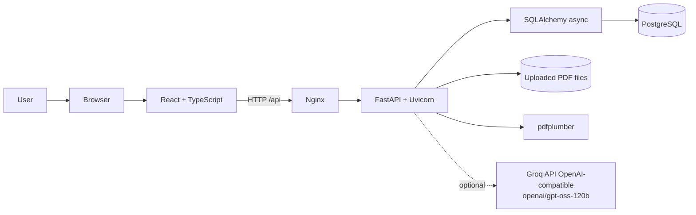

# Senus PLC Board Report

## Run with Docker

From the repository root, make sure Docker Desktop is running. On a clean checkout,
create the backend environment file and the two external Docker volumes required by
Compose:

```powershell
if (-not (Test-Path backend\.env)) {
  Copy-Item backend\.env.example backend\.env
}
docker volume create senus_plc_board_postgres_data
docker volume create senus_plc_board_uploads
```

Build and start the application:

```powershell
docker compose up --build
```

Open the app at [http://localhost:8080](http://localhost:8080). The API documentation
is available at [http://localhost:8000/docs](http://localhost:8000/docs). Stop the
containers with `Ctrl+C`, or run `docker compose down` from another terminal. The
database and uploaded files are stored in Docker volumes and persist when the
containers are stopped.

The Groq integration is optional. The copied `.env.example` contains a placeholder
value: replace it with a valid `GROQ_API_KEY` to enable AI extraction, insights, and
chat, or set `GROQ_API_KEY=` to leave the integration disabled. The deterministic
parser and the rest of the application work without a key.

## Overview

This web application uploads Senus PLC financial reports, detects and reviews
periods and figures, calculates deterministic KPIs, and displays a dashboard. The
workflow is designed for users with the `admin` role (ingestion and review) and the
`viewer` role (read-only access). Run it locally with Docker as described above.

For a concise design rationale covering the technology choices, database model,
ingestion workflow, and remaining gaps, see the
[one-page design write-up](ONE_PAGE_WRITE_UP.md).

## Observed architecture



Compose defines services for PostgreSQL 16, the API, and the frontend. The frontend
container serves the Vite build with Nginx and forwards `/api/` requests to FastAPI.
Alembic runs database migrations before Uvicorn starts. Uploaded PDFs are stored as
files; financial and audit records are stored in PostgreSQL (`docker-compose.yml`,
`Dockerfile`, `backend/Dockerfile`, `nginx.conf`, `backend/app/main.py`).

| Technology | Verified use in this repository |
|---|---|
| React 19 and TypeScript | SPA, screens, and HTTP client contracts (`src/`) |
| Vite | Frontend development and build (`package.json`, `vite.config.ts`) |
| Recharts | Dashboard charts (`src/components/Dashboard.tsx`) |
| FastAPI and Pydantic | REST API, schema validation, and OpenAPI documentation (`backend/app/`) |
| SQLAlchemy async and asyncpg | Asynchronous access to the relational model (`backend/app/core/database.py`) |
| PostgreSQL | Persistence configured in Compose (`docker-compose.yml`) |
| Alembic | Versioned migrations (`backend/alembic/`) |
| pdfplumber and regular expressions | PDF text reading and deterministic extraction (`backend/app/services/ingest.py`, `backend/scripts/extract_pdf.py`) |
| Groq, OpenAI-compatible client | Optional second extractor and Company insights/chat; requires `GROQ_API_KEY` (`backend/app/core/config.py`, `backend/app/services/llm_extract.py`, `backend/app/services/company_ai.py`) |
| pytest, Vitest, ESLint | Backend tests, frontend tests, and lint (`backend/tests/`, `src/api/client.test.ts`, `package.json`) |

The table describes observed usage. The design write-up explains the practical role
of these choices in the implemented system.

The default model is `openai/gpt-oss-120b`. The base URL is Groq's
OpenAI-compatible API. Without an API key, the deterministic parser and core
application remain available, but new LLM extractions and Company AI insights/chat
are unavailable and return 503 (`backend/app/core/config.py`,
`backend/app/services/llm_extract.py`, `backend/app/services/company_ai.py`).

## Screens and roles

- **Login:** authenticates through `/api/auth/login`; passwords are stored with
  bcrypt and the API returns JWT tokens (`src/components/Login.tsx`,
  `backend/app/api/auth.py`, `backend/app/core/security.py`).
- **Company (default view):** management report with metrics, the Senus 2030 target,
  pipeline, customers, people, milestones, three AI insights, and AI chat
  (`src/components/Company.tsx`, `src/components/CompanyAI.tsx`).
- **Financials (Dashboard):** displays KPIs, their source/formula or availability
  note, revenue and margin charts, cost breakdown, EBITDA-to-cash-flow bridge,
  ratios, and period comparisons. It no longer displays AI insights or the
  "How to read these ratios" note (`src/components/Dashboard.tsx`).
- **Period comparison:** the period selected in the header is one of the two periods;
  the user only selects which period to compare it with. The order is always
  chronological (older period first, newer period second) in the table, bridge, and
  charts (`src/components/PeriodComparison.tsx`).
- **Documents:** lists documents; admins can upload PDFs, confirm dates, process
  columns, review and correct figures, publish, and delete documents. Includes
  provenance and sorting by extraction confidence (`src/components/Ingestion.tsx`,
  `backend/app/api/documents.py`).
- **Period selector:** appears in the global header, not inside the Dashboard
  (`src/components/Header.tsx`, `src/App.tsx`).
- **Permissions:** viewers can read; write operations require the `admin` role in the
  backend. There is no audience selector or audience-based permission system
  (`backend/app/core/security.py`, `backend/app/api/`).

The Dashboard groups profitability, cash/liquidity, solvency, and return ratios. It
includes Revenue, Gross Margin, Operating Margin, Cash, and Cash Runway cards, as
well as chart comparisons and source data. MoM, revenue by channel, and bookings are
shown as unavailable rather than estimated (`src/components/Dashboard.tsx`,
`backend/app/services/metrics.py`).

## Data model

The main SQLAlchemy entities and their relationships are defined in
`backend/app/models/financial.py`:

- `Document` contains metadata, the PDF path, status, detected periods, and review
  payload. It can have multiple `Period` records.
- `Period` contains dates, a label, and its source document; it groups P&L, balance
  sheet, cash flow, KPI, insight, and validation records.
- `PnLItem`, `BalanceSheetItem`, and `CashFlowItem` store figures, source, page,
  review status, and confidence factors.
- `KPI` stores a nullable value, class (`reported`, `derived`, or `na`), formula, and
  note.
- `Insight` is a legacy table for verified Financials insights, which have been
  removed from the API and interface; it remains because of the migrations.
- `Validation` stores the rule, severity, message, expected value, and observed value.
- `User` stores the role and password hash; `AuditLog` records operations and changes.

## PDF ingestion and period confirmation

1. **Upload and reading:** only `.pdf` files are accepted. `pdfplumber` extracts text
   page by page; this workflow does not use OCR (`backend/app/api/documents.py`,
   `backend/app/services/ingest.py`).
2. **Date and column detection:** `period_detector.py` searches financial statement
   headers and dates using regular expressions. The label is derived from the start
   and end dates; for example, FY2025 runs from 1 Jul 2024 to 30 Jun 2025, and HY2026
   runs from 1 Jul 2025 to 31 Dec 2025. The fiscal year ends on 30 June. Ambiguous
   headers such as "Current period" and "Prior period" are left without dates and
   require manual input. An LLM is not used to validate or invent dates; the detector
   and consistency rules are deterministic (`backend/app/services/period_detector.py`).
3. **Confirmation before extracting figures:** the UI displays columns, dates, and
   errors. Processing cannot start until every period has been confirmed without
   errors. The label is recalculated when dates change. Manual changes record the
   user, timestamp, and previous/new values in `audit_log`
   (`backend/app/api/documents.py`, `backend/app/schemas/documents.py`).
4. **Temporal consistency:** detected columns must have the same duration; if there
   are two columns, the comparative period must be exactly 12 months earlier; and
   detected P&L, balance sheet, and cash flow headers must match. If a check fails,
   the document remains unconfirmed and processing is blocked
   (`backend/app/services/period_detector.py`, `backend/app/api/documents.py`).
5. **Dual extraction:** the regex parser extracts the selected column and preserves
   page-level provenance. If `GROQ_API_KEY` is set, the LLM extractor returns
   structured line items with page and source text; each figure must appear in the
   cited page's text (`backend/scripts/extract_pdf.py`,
   `backend/app/services/llm_extract.py`).
6. **Reconciliation and review:** when the extractors disagree, the deterministic
   parser takes precedence; the alternative value is retained and the line item is
   flagged for review. Disagreements are not silently corrected. An admin can confirm
   or correct figures; publishing updates the document lifecycle
   (`backend/app/services/reconciliation.py`, `backend/app/services/lifecycle.py`,
   `backend/app/services/ingest.py`).
7. **KPIs and validations:** after extraction or correction, the backend recalculates
   KPIs and accounting checks using Python code
   (`backend/app/services/deterministic.py`, `backend/app/services/validation.py`).

Parser precedence makes the initial selection reproducible and leaves LLM output as
alternative evidence for review; it does not mean that the parser is infallible.
KPIs are calculated with Python formulas so results do not depend on a model's text
response and can be covered by tests (`backend/app/services/reconciliation.py`,
`backend/scripts/extract_pdf.py`, `backend/tests/test_kpis.py`).

If processing would replace existing periods, the backend returns a conflict and the
UI asks for confirmation before retrying. The decision and replaced periods are
recorded in the processing log (`backend/app/api/documents.py`,
`src/components/Ingestion.tsx`).

The confidence score for each line item is the simple average of applicable checks:
exact agreement between extractors, presence of the figure in the page text, and
related accounting identity checks. If there is no second extractor, the agreement
factor fails; identities without sufficient data are not counted. The screen can sort
by the least reliable figures (`backend/app/services/reconciliation.py`,
`src/components/Ingestion.tsx`).

## Company view and narrative extraction

The default **Company** view displays management, customers, milestones, pipeline,
the Senus 2030 strategy, and people. All of this information comes from the original
PDF, with no external data:

- `backend/app/services/narrative.py` deterministically extracts (without an LLM)
  the profile, highlights, customers, milestones, drivers, and notes. Every item
  includes the **page** and a **verbatim quote**; an item is discarded if its quote
  does not appear on that page.
- The data is saved in `documents.narrative_json` (migration `e1f4a7c9d2b3`) during
  ingestion and served by `GET /api/company?period=`. If it is missing, it is
  extracted from the PDF on demand. Seeded data without a PDF returns 404.
- `checks` contains cross-checks between narrative figures (for example, the
  approximately €425k from Nov–Dec must fit within the approximately €700k closed
  during the period).
- `backend/scripts/compare_narrative_to_txt.py` compares the extraction with the
  reference TXT (`Otros/`); `tests/test_narrative.py` requires at least 99% coverage.
- After an update, run `python -m alembic upgrade head` and reprocess the PDF from
  Documents.
- The target chart only shows the target arithmetic (at least 50% annual growth over
  FY25 revenue, `strategy.min_cagr_pct`); it is not a forecast because the report
  does not state when the pipeline will convert into revenue.
- Information without a source in the PDF (share price, CEO, revenue by product
  line) is not displayed.

### Company AI insights and chat

These are generated text, not quotes from the PDF, and the view labels them
accordingly. They require `GROQ_API_KEY` in `backend/.env`; without a key they return
503 while the rest of the view continues to work.

- `GET /api/company/insights?period=&force=` returns three interpretations (title
  and text); they are cached in process memory, and `force=true` regenerates them.
- `POST /api/company/chat` answers questions using recent conversation history (up to
  eight turns).
- The context is the extracted narrative (without quotes or page numbers), `checks`
  notes, and the financial statement line items for the period. The prompt prohibits
  inventing figures, forecasts, or probabilities, and adding amounts that `checks`
  marks as overlapping (`backend/app/services/company_ai.py`,
  `backend/app/api/company.py`, `backend/tests/test_company_ai.py`).

## Data, sources, and KPIs

Each figure/KPI is classified as:

- `reported`: reported in a document or identified source.
- `derived`: calculated by the system; the formula is returned as metadata.
- `n/a` (`na` in the schema): unavailable, with an explanatory note when applicable.

Missing values are preserved as `null`; they are not replaced with zero. The catalog
includes margins, EBITDA, FCF, monthly burn, runway, liquidity ratios, solvency,
leverage, returns, and DSCR, among others. Example formulas include
`Gross profit / Revenue × 100`, `Cash / Monthly burn`, and
`Net cash from operations / (Interest + abs(Loan repayments))`
(`backend/app/services/metrics.py`, `backend/scripts/extract_pdf.py`).

MoM, sales by channel, and bookings are not available in the current sources and are
shown as `n/a`. DSCR is `n/a` when operating cash flow is negative. The backend
rejects comparisons of different durations with HTTP 422; the summary's YoY series
also requires start dates one year apart and equal period durations
(`backend/app/services/metrics.py`, `backend/app/api/financial.py`).

FY2025 is a partial period, not a processed document: revenue of **€836,991** and
138 customer accounts come from the assignment brief; opening cash of **€140,135**
comes from the HY2026 cash flow statement. Margins, EBITDA, and runway are not
derived for FY2025, and the remaining line items are absent
(`backend/scripts/extracted/fy2025_extracted.json`, `backend/tests/test_fixtures.py`).

## Validations and conventions

Deterministic checks use a tolerance of **±€1**. Checks are skipped when required
inputs are missing; subtotal identities treat a missing line item as zero. The
implemented rules include:

1. Revenue − Cost of sales = Gross Profit (**error**).
2. Assets − liabilities = equity/net assets (**error**).
3. Operating result + depreciation = EBITDA (**error**).
4. Opening cash + net change = closing cash (**error**).
5. Balance sheet subtotals equal the sum of their components (**warning**).

The HY2025 source has a specific discrepancy: on page 5 of the PDF, the comparative
column reports revenue of €340,931, cost of sales of €69,600, and Gross Profit of
€272,331. However, `€340,931 − €69,600 = €271,331`, a difference of €1,000, which
exceeds the tolerance. Extraction preserves the printed subtotal and the accounting
rule flags it; it does not correct it (`backend/data/Senus_HY2026_Interim_Results.pdf`,
`backend/tests/test_extract.py`, `backend/app/services/validation.py`).

The parser normalizes certain loss line items to negative values when they appear as
positive values, including operating loss and loss for the period. EBITDA is derived
as operating result + depreciation. Other line-item signs follow the parsed document
value; the parser does not claim to normalize all costs automatically
(`backend/scripts/extract_pdf.py`).

## Demo and reproducible data

Extracted fixtures for HY2026, HY2025, and partial FY2025 are in
`backend/scripts/extracted/`. In Compose, `SEED_FROM_DISK=false` prevents periods
from being loaded automatically on startup. The
`backend/scripts/reset_demo.py` script deletes records from the configured database,
recreates the demo users, and loads those three fixtures. It is destructive and
requires `--confirm`; check `DATABASE_URL` before using it. The fixtures do not
restore the original PDFs. The reset script was not run against a database during
this validation.

## Tests and verification

Run these commands from the repository root:

```powershell
python -m pytest backend\tests -q
npm test -- --run
npm run build
npm run lint
```

Results observed in this checkout:

- Backend: **91 passed**, 7 warnings (Pydantic deprecated-config and a short HMAC
  key in the security test).
- Frontend: **6 passed**.
- TypeScript/Vite build: **successful**; Vite warns that the main JavaScript chunk
  exceeds 500 kB minified.
- Lint: **fails** on `react-hooks/set-state-in-effect` in
  `src/components/Dashboard.tsx`; it also reports two hook dependency warnings in
  `Dashboard.tsx` and `App.tsx`. Lint is not claimed to be clean.
- CI (`.github/workflows/ci.yml`) runs pytest, Vitest, and the build; it does not run
  ESLint.

A targeted check was made against the text extracted directly from page 5 of the
source PDF for the three HY2025 comparative figures noted above. No independent
visual review of every report line item or live Groq validation call was performed;
provider tests use mocked responses.

## AI-assisted development

Development used both OpenCode with free models and the paid GitHub Copilot service.
The main product and architecture decisions were made before using AI to implement
them. Where domain knowledge was missing—for example, when deciding which financial
KPIs would be useful—AI was asked to propose a list; that output supported the
decision rather than replacing it.

AI assistance was used to develop the frontend and to iterate on improvements to
document ingestion. It was also used to create and run tests and to diagnose and fix
errors found during development. At runtime, the optional financial extraction and
Company insights/chat integration is a separate Groq API integration; OpenCode and
Copilot are development tools, not application dependencies.

## Security

- **SQL injection:** all database access goes through SQLAlchemy's ORM with bound
  parameters; the backend contains no string-built SQL.
- **File uploads:** admin-only; the API enforces a 20 MB limit (Nginx also rejects
  bodies over 21 MB), requires the `.pdf` extension and `%PDF-` magic bytes,
  sanitises the stored filename (random UUID prefix, restricted characters), and
  deletes files that `pdfplumber` cannot parse.
- **Frontend:** React escapes rendered values and the code does not use
  `dangerouslySetInnerHTML`. Nginx sends `Content-Security-Policy`,
  `X-Content-Type-Options`, `X-Frame-Options`, and `Referrer-Policy` headers.
- **Authentication:** bcrypt password hashes, signed JWTs, and server-side `admin`
  checks on write endpoints. CORS is limited to the local development origins.
  Login is throttled in memory: five failed attempts lock the account for five
  minutes (per process).

**Demo credentials (intentional):** this is a demo, so the login page pre-fills and
displays the seeded accounts (`board@senus.com` as admin and `viewer@senus.com` as
read-only, both with password `senus123`) to make evaluation easy. This is a
deliberate trade-off, not an oversight; a real deployment would remove the
pre-filled credentials, the on-screen hint, and the seeded users, and set a strong
`SECRET_KEY`.

Known security gaps (accepted for this demo, to fix before any real use):

- **Transport:** the app is served over plain HTTP, so credentials and JWTs travel
  unencrypted. Production needs HTTPS (TLS termination).
- **Token storage:** the JWT is kept in `localStorage` (readable by any XSS); an
  HttpOnly cookie would be safer. Tokens last 8 hours and cannot be revoked.
- **Secrets and credentials:** the default `SECRET_KEY` and database password
  (`senus_dev`) are unchanged, and the demo accounts are public (see above).
- **Exposed services:** Compose binds PostgreSQL (5432) and the API (8000) to
  `127.0.0.1` only; the frontend (8080) is the only public port. The API runs
  without `--reload`, so code changes require `docker compose up --build`.
- **Uploads:** files are not antivirus-scanned and are parsed with `pdfplumber`
  inside the API process; a malicious PDF could exhaust resources.
- **LLM data and prompt injection:** when `GROQ_API_KEY` is set, document text is
  sent to Groq, a third party. Text inside an uploaded PDF could attempt prompt
  injection; mitigations are page-text grounding, deterministic precedence, and
  human review, not a guarantee.
- **Login throttle:** in-memory and per process; it resets on restart and does not
  work across several instances.
- **CSP:** it allows `'unsafe-inline'` styles (needed by the current frontend).
- **Authorisation:** only two roles; viewers can read every document and download
  the original PDFs. There is no per-document or per-audience access control.

## Known limitations

- The PDF workflow extracts text with `pdfplumber`; it does not OCR scanned pages.
- The parser is tuned to two-column tabular statements and the labels and line breaks
  covered by its patterns/tests; general support for arbitrary report layouts has
  not been verified.
- The included sources do not contain monthly data, sales by channel, or bookings;
  these are shown as `n/a`.
- FY2025 contains only the explicit data described above.
- The Dashboard code displays a "50% CAGR track" reference calculated as 1.5 × FY2025
  revenue; it is not a catalog KPI or a figure calculated from monthly periods
  (`src/components/Dashboard.tsx`).
- There is no audience selector. The current roles are `admin` and `viewer`.
- The demo reset and the state of an external database were not verified by running
  the script against that database.
